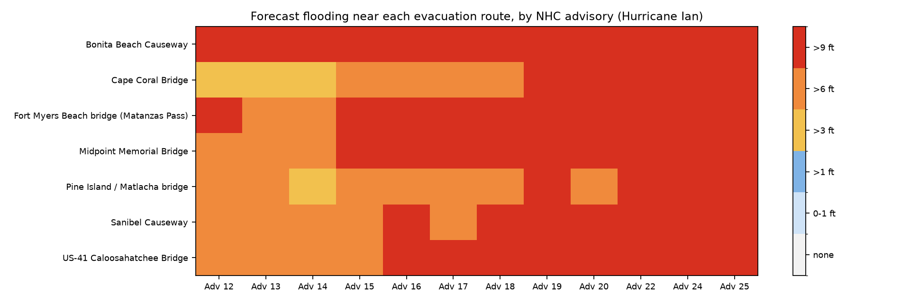
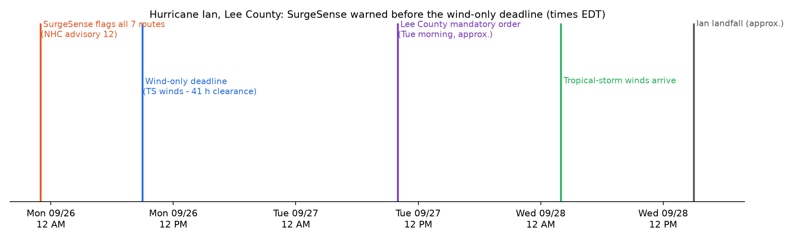

# SurgeSense

**An agentic AI advisor that warns emergency managers when storm surge will cut off evacuation routes, not just when the wind arrives.**

Built for the IBM SkillsBuild AI Experiential Learning Lab with **IBM Bob** and **IBM Granite**. A **watsonx Orchestrate** agent is in progress.



## The problem

When a hurricane approaches, coastal emergency managers must decide when to order an evacuation. FEMA's HURREVAC, the standard decision tool, sets evacuation timing from when tropical-storm-force winds arrive minus how long a zone takes to clear. Storm surge and rain appear as separate map layers, but they don't change that calculation, and the tool does not model when evacuation routes become impassable.

Wind is not always what traps people. In Hurricane Ian (2022), storm surge washed out the Sanibel Causeway and the Pine Island approach and closed the Bonita Beach Causeway bridges, cutting islands off from the mainland.

## What SurgeSense does

1. Reads NHC **Potential Storm Surge Flooding** forecasts for every advisory.
2. Measures forecast flood depth at each evacuation route.
3. Flags a route as **impassable** when forecast water depth reaches the roadway (elevation-aware rule).
4. Compares that warning with the **wind-only deadline** (34-kt wind arrival minus clearance time).
5. Checks the flags against what actually happened.
6. Replays the storm advisory by advisory and issues an alert at each change: code writes the facts, **IBM Granite** (run locally with Ollama) writes plain-language guidance, and a validator rejects guidance that adds numbers or mislabels a route, falling back to a fixed template.
7. Produces a plain-language briefing (`docs/surgesense_briefing.md`) for emergency managers, which will be the knowledge source for a watsonx Orchestrate agent (in progress).

## Results: Hurricane Ian replay, Lee County, FL

Seven evacuation routes, NHC advisories 12–25.

| Event | Time (EDT) |
|---|---|
| SurgeSense flags the low-lying routes (first available flood map, advisory 12) | Sun Sep 25, 11 PM |
| Wind-only deadline (34-kt arrival − 41 h clearance) | Mon Sep 26, 9 AM |
| Lee County mandatory evacuation order | Tue Sep 27, morning (approx.) |
| Tropical-storm-force winds reach the routes | Wed Sep 28, 2 AM |

- SurgeSense warned **10 hours before the wind-only deadline**, and more than a day before Lee County's order.
- Against real outcomes, the elevation-aware rule **caught all 3 routes that closed with 0 false alarms**. A depth-only rule also caught all 3 but raised 4 false alarms, all on high-span bridges.



## How it works

```
NHC inundation GeoTIFFs ──► flood_check.py ──► route_flood.csv ─┐
NHC best track (34-kt radii) ──► deadlines.py ──► deadlines.csv ─┼─► evaluate.py ──► evaluation.csv
Lee County closure records (config/outcomes.csv) ───────────────┘
                                   │
                                   ├─► demo_charts.py ──► docs/*.png
                                   ├─► briefing.py ──► docs/surgesense_briefing.md ──► watsonx Orchestrate agent (in progress)
                                   └─► app.py (Streamlit dashboard)
```

| Script | Purpose |
|---|---|
| `src/download_ian.py` | Downloads NHC inundation forecasts and Ian's best track |
| `src/flood_check.py` | Max flood class near each route per advisory; elevation-aware impassable flag |
| `src/deadlines.py` | Wind arrival, wind-only deadline, SurgeSense lead time; timeline chart |
| `src/evaluate.py` | Compares both rules against real Ian closures |
| `src/demo_charts.py` | Presentation timeline and flood heatmap |
| `src/briefing.py` | Plain-language briefing used as the agent's knowledge |
| `src/replay_agent.py` | Advisory replay agent: change detection, Granite guidance, validator, template fallback → `docs/alerts.md` |
| `src/app.py` | Interactive dashboard: map, advisory slider, rule toggle |
| `src/run_pipeline.py` | Runs all analysis steps in order |
| `src/inspect_raster.py`, `src/probe_routes.py` | Diagnostics used while exploring the data |

## Run it

Requires Python 3.10+.

```bash
pip install -r requirements.txt
python src/download_ian.py          # downloads NHC data into data/raw/
ollama pull granite4.1:3b           # optional: IBM Granite for alert guidance
python src/run_pipeline.py          # runs the analysis
python -m streamlit run src/app.py  # opens the dashboard
```

Raw and processed data are not committed (see `.gitignore`); the download script documents every source.

## IBM technology

- **IBM Bob** (IDE) built the core pipeline: route flood check, deadline comparison, elevation-aware rule and dashboard. Task session screenshots are in [`bob_sessions/`](bob_sessions/).
- **IBM Granite** (`granite4.1:3b`, open model run locally with Ollama) writes alert guidance in the replay agent. In the Ian replay, 7 of 10 Granite drafts passed validation; the other 3 were replaced by the template.
- **IBM watsonx Orchestrate** (in progress): we are building a SurgeSense agent that uses `docs/surgesense_briefing.md` as its knowledge source so emergency managers can ask about route risk, timing and limitations in chat. It is not part of the submitted demo yet.

## Limitations

- NHC inundation maps show **forecast peak flooding** (a 1-in-10 worst case), not when flooding starts.
- Each route is checked at one point with a search radius, not along the whole road.
- Wind arrival uses the 6-hourly best track; 41 h is Lee County's worst-case in-county clearance time.
- Low-road heights (3 ft) are assumed. The elevation rule was chosen after seeing Ian's outcomes and needs testing on other storms. High-bridge approach flooding is not modeled.
- Lee County's order time is approximate (reported as Tuesday morning).
- The guidance validator checks for numbers and for passable routes described as blocked; it does not catch every possible wording error.

## Next steps

- Survey-based roadway elevations and full road geometry from OpenStreetMap.
- Train a model on closures from multiple storms (Ian, Idalia, Helene, Milton).
- Add rainfall as a third hazard and time-stepped surge to estimate when flooding starts.
- What-if storm scenarios with IBM-NASA's Prithvi WxC.
- Finish and deploy the watsonx Orchestrate agent, then wrap the pipeline as an Orchestrate tool so the agent re-runs the analysis on each new advisory.

## Data sources and licenses

- NOAA / National Hurricane Center: Potential Storm Surge Flooding maps and best track for Ian (AL092022). U.S. government work, public domain.
- Lee County Government: evacuation clearance times and post-Ian bridge closure updates.
- Route coordinates and bridge clearances: published bridge records (see `config/`).
- Map tiles in the dashboard: © OpenStreetMap contributors.

Code is released under the MIT License (see `LICENSE`).
